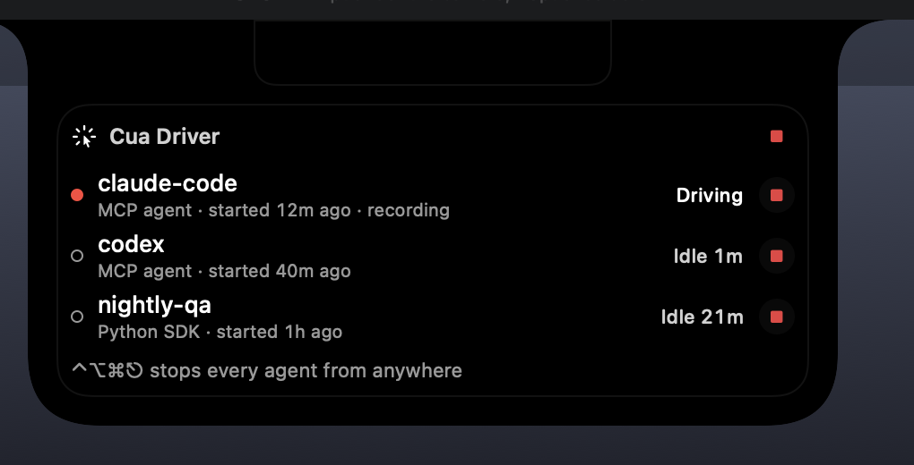
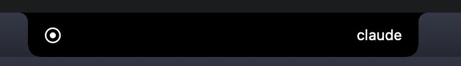
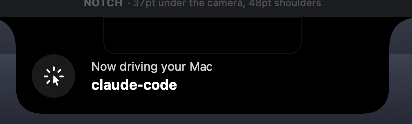
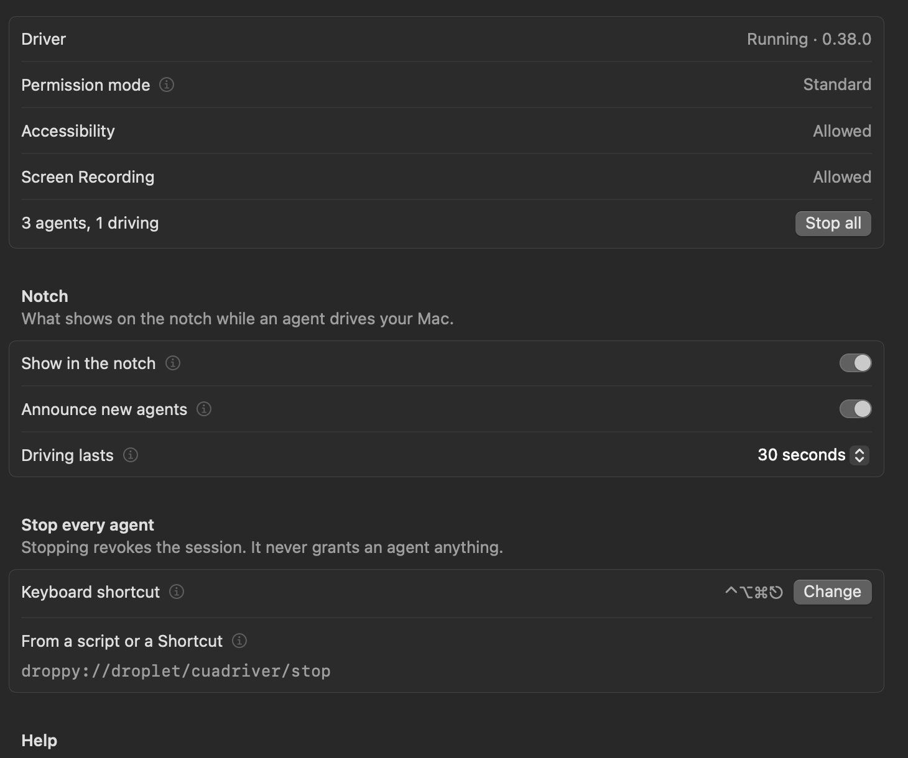

# Cua Driver for Droppy

A [Droppy](https://getdroppy.app) droplet for [cua-driver](https://github.com/trycua/cua). It shows you when an agent is driving your Mac, and gives you a few ways to stop it.



## What it does

While a session is acting, the notch shows a cursor glyph and the session's name. The glyph turns into a record mark while that agent records the screen, and with several agents driving you get a count instead, like `×2`. Agents pause to think between actions, so a session keeps counting as driving for 30 seconds after its last one (anything from 15 seconds to 2 minutes, in Settings). That keeps the notch from flickering.



When an agent starts driving, a card drops out of the notch with its name. You won't get one for sessions that were already running when Droppy started or while the Mac was asleep, and you can turn the card off.



The shelf widget lists every session the driver is running: its name, the kind of client, when it started, how long ago it last acted, and a Stop button. Beside another widget it just shows how many agents are driving.

With no agent connected, the widget says whether cua-driver has Accessibility and Screen Recording. Settings also shows the driver's version and permission mode. If the driver runs in unrestricted mode, where agents act without asking, the widget's header shows a warning.



## Stopping an agent

There are four ways:

- The Stop button on a session's row ends that session.
- The stop disc in the widget's header ends all of them, and blocks new ones.
- ⌃⌥⌘⎋ stops every agent from any app, even with the shelf closed, and a card on the notch tells you how many it stopped. You can rebind it on Droppy's Shortcuts page.
- Opening `droppy://droplet/cuadriver/stop` does the same as the shortcut, so a script, a Shortcut or a launcher can stop everything:

  ```bash
  open "droppy://droplet/cuadriver/stop"
  ```

Stopping every agent is a kill switch. After it, cua-driver refuses every call from every agent until the driver restarts (`cua-driver stop`, then `cua-driver serve`), and the widget and Settings say so for as long as that lasts. Stopping a single session doesn't block anything else.

Stopping only revokes. It can't start a session or grant one anything, which is why it's fine that any app on the Mac can open that URL. A session without a label can't be stopped by name, so its Stop button stops every agent.

## How it works

The droplet talks to the cua-driver daemon over its local socket, `~/Library/Caches/cua-driver/cua-driver.sock`. Each request and each answer is one JSON object per line:

| What | Request |
| --- | --- |
| List sessions from every client | `{"method":"sessions_list"}` |
| Driver version | `{"method":"metadata"}` |
| Permission mode | `{"method":"authorization_status"}` |
| Accessibility and Screen Recording | `{"method":"call","name":"check_permissions","args":{}}` |
| Stop one session | `{"method":"revoke_authorization","args":{"session":"<label>"}}` |
| Stop every session | `{"method":"revoke_authorization","args":{"all":true}}` |

It asks for the session list every 2 seconds while an agent drives, every 3 seconds while sessions sit idle, and every 5 seconds with none. When the daemon isn't running it checks every 30 seconds, and it also watches the socket's folder, so it notices a daemon starting within a moment. The version, mode and permissions are read when the daemon comes up, when the widget or Settings comes on screen, and every 30 seconds while one of them is there. Every socket call runs on a background queue with a 1.5-second limit, and a Mac waking from sleep triggers a read straight away.

The daemon keeps listing a revoked session as `active` until it expires, so the droplet hides any session it stopped until that session acts again. After a revoke of every session, the daemon answers each later call with the refusal code `authorization_suspended`; that's how the droplet tells a blocked driver from one that lacks permissions.

The daemon's protocol isn't documented as a public API. I worked it out from cua-driver 0.38.0 and its source, so a later driver release could change it.

## Privacy

The droplet reads session labels, client kinds and timings from the daemon. It never reads what an agent sees or does, and it doesn't send anything off your Mac. It stores your three settings in Droppy's preferences and nothing else.

## Requirements

- cua-driver running on the same Mac (`cua-driver serve`, or any agent that starts it)
- Droppy 15.3 or later

## Install

Cua Driver isn't in the Droppy Store yet, so for now you install a build from [Releases](../../releases).

1. Download `Cuadriver-<version>.droplet.zip` from the latest release and unzip it. You get `Cuadriver.droplet`.
2. In Droppy, open Settings › Store › Local droplets, add `Cuadriver.droplet` and approve it.

This build isn't signed by Droppy, so Droppy asks you to approve it again each time it opens. [Droppy Playground](https://getdroppy.app/download/playground) runs it without asking: put it in `~/Library/Application Support/Droppy Playground/Droplets/cuadriver/` and relaunch the Playground. Once the droplet is in the Store, Droppy signs it and the prompt goes away.

## Developing

Set up the DroppyKit SDK first ([Add the package](https://getdroppy.app/docs/droppykit/add-spm)), then:

```bash
droppykit run        # the harness, with sample sessions
CUADRIVER_LIVE=1 droppykit run   # the harness against the daemon on this Mac
droppykit build      # .build/Cuadriver.droplet
droppykit validate   # the Store's checks
droppykit run -- --shots ./shots --report ./shots/report.json
```

The harness shows three sample sessions and an agent's card on the notch, so every surface has something on it. Stop removes the sample rows without talking to any daemon.

To try it in Droppy Playground, copy `.build/Cuadriver.droplet` to `~/Library/Application Support/Droppy Playground/Droplets/cuadriver/` and relaunch the Playground. In Droppy itself, add it under Settings › Store › Local droplets.

## Before submitting to the Store

- `Cuadriver.icon` is a placeholder, and the Droppy team designs Store icons. Icon idea for the merge request: the `cursorarrow.rays` SF Symbol, maybe with a stop mark.
- `droppykit submit` fills in `creator.gitlab` from your signed-in `glab` account.
- The droplet connects to a local Unix socket that belongs to another app. No DroppyKit capability covers that, so ask the Droppy team about it in the merge request.
